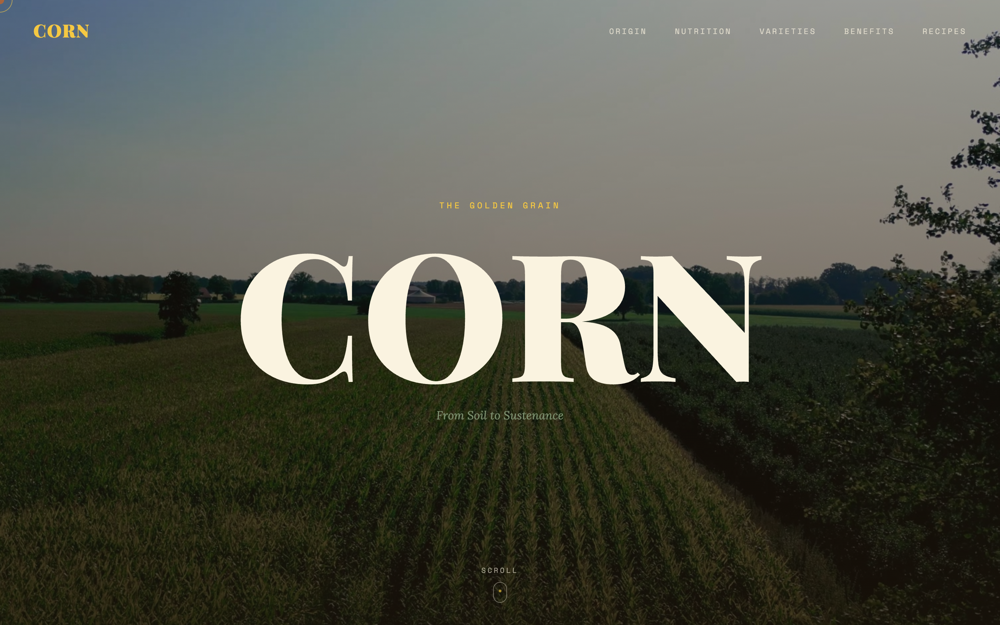

# Corn — Golden Grain

**Interactive Nutritional Showcase & Express/MongoDB Content Platform**


A scroll-driven single-product editorial showcase celebrating golden corn, its origins, nutritional profile, varieties, and culinary recipes—backed by a Node.js, Express, and Mongoose API with Netlify Serverless Function support.

- **Live Website:** [https://heartfelt-pika-32c756.netlify.app/](https://heartfelt-pika-32c756.netlify.app/)

---

## Screenshots



---

## Core Features

- **Scroll-Driven Editorial Experience**: Combines `gsap` scroll triggers (`useScrollAnimation`) and `lenis` smooth scrolling across `Hero`, `CinematicScene`, `VideoScene`, `MediaReveal`, and `FullBleedImage` sections.
- **Interactive Nutrition & Variety Explorer**: Presents structured data cards for `CornOrigin`, `NutritionCard`, `HealthBenefits`, `Varieties`, `RecipeCard`, and `DidYouKnow` facts.
- **Full-Stack API & Seeder**: Express + Mongoose backend (`nutritionRoutes`, `varietyRoutes`, `recipeRoutes`) with seed data (`server/seed/seedData.js`) and `serverless-http` wrapper for Netlify Functions (`netlify/functions/api.js`).
- **Lightweight Client State**: Uses `zustand` and React Context (`AppContext`) paired with `axios` for fetching backend content.

---

## Tech Stack

| Layer | Technology |
| :--- | :--- |
| **Frontend** | React 19, Vite 8, React Router DOM 7, Tailwind CSS 3, Zustand 5, Axios |
| **Animation** | GSAP 3.15, Lenis 1.3 (`@studio-freight/lenis`) |
| **Backend API** | Node.js, Express 5, Mongoose 9, Helmet, Morgan, CORS |
| **Serverless & Hosting** | Netlify Functions (`serverless-http`), Netlify Hosting (`netlify.toml`) |

---

## Project Structure

```text
Corn-golden-grain-A-single-product-frontend-page/
├── client/                              # React + Vite frontend
│   ├── src/
│   │   ├── components/                  # Hero, CinematicScene, NutritionCard, Varieties, etc.
│   │   ├── context/AppContext.jsx
│   │   ├── hooks/useScrollAnimation.js
│   │   ├── pages/Home.jsx
│   │   └── main.jsx
│   └── package.json
├── server/                              # Express + Mongoose backend
│   ├── config/db.js
│   ├── controllers/                     # nutrition, recipe & variety controllers
│   ├── models/                          # CornVariety, Nutrition, Recipe schemas
│   ├── routes/                          # REST API route modules
│   ├── seed/seedData.js
│   └── server.js
├── netlify/functions/api.js             # Serverless API adapter
├── netlify.toml
└── docs/screenshots/home.png
```

---

## Local Setup

### Prerequisites

- Node.js 18+
- MongoDB (for the optional backend API)

### 1. Run Frontend Client

```bash
git clone https://github.com/IFTI-KAR/Corn-golden-grain-A-single-product-frontend-page.git
cd Corn-golden-grain-A-single-product-frontend-page/client
npm install
npm run dev
```

### 2. Run Backend API (Optional)

```bash
cd ../server
npm install
# Add MONGO_URI in .env, then start Express
node server.js
```
